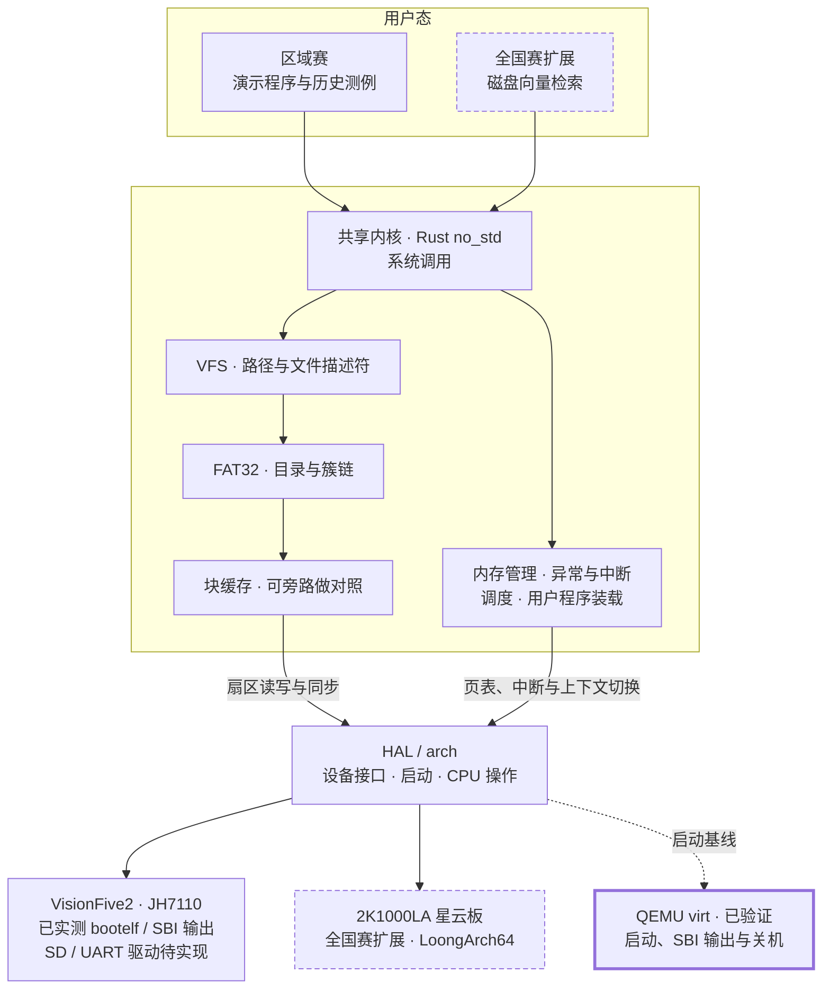

# 从用户程序到磁盘

这张图画的是 FocOS 的目标架构。当前已验证 QEMU 启动、SBI 输出与关机，以及 VisionFive2 上 U-Boot 加载 FocOS 后的 SBI 输出（[实测记录](evidence/BOARD-001-20261105.txt)）；真板 UART/SD 驱动和其余内核功能待实现。区域赛先在 VisionFive2 上接通整条路径，全国赛再移植到星云板并验证同一套文件系统。

## 跟着一次读文件走

用户程序发出系统调用。VFS 是统一的文件接口，负责解析路径并管理文件描述符。FAT32 沿目录和簇链找到文件数据。块缓存可以复用已经读过的扇区，未命中时再通过 `BlockDevice` 接口交给板级驱动读取。

移植星云板时，启动、页表、中断和设备驱动在 HAL 与 arch 层适配。VFS、FAT32 和缓存继续使用同一份源代码，按相同的文件操作用例验收。

## 未来怎样验证优化

1. **先跑通区域赛闭环。** 在 VisionFive2 上用用户程序创建文件、跨簇写入、同步后重启读回。历史测例用于核验它们覆盖的系统调用行为。
2. **再解释缓存的收益。** 在同一板卡上用同一镜像和请求序列比较缓存开关，记录物理 I/O 次数、内存开销和尾延迟。星云板移植完成后，重复同样的对照。
3. **最后换成真实应用负载。** 全国赛用用户程序从 FAT32 文件按需读取图节点和向量。在同一召回率和内存预算下，对比每次查询的 I/O 次数与端到端延迟。

如果当届全国赛要求其他文件系统或更完整的 Linux ABI，分别在 VFS 下增加兼容后端、扩展系统调用层。FAT32 继续作为基础文件系统和优化对象。

按周验收看 [推进路线](roadmap.md)，接口细节看 [详细设计约束](reference/delivery-details.md)，采样与绘图看 [性能实验](benchmarks.md)。
